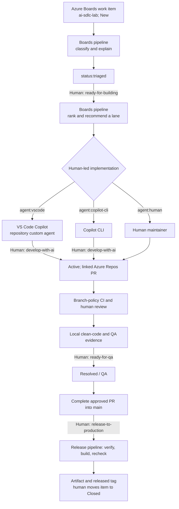

# Azure DevOps AI SDLC workflow reference

## AI SDLC flow

Only a person adds approval tags. The board pipeline recommends a route; it does not assign a work item, start Copilot, approve a PR, or change the Agile state.

## Tags and board state

| Tag | Added by | Meaning |
| --- | --- | --- |
| `ai-sdlc-lab` | Human | Opts an Agile User Story or Bug into this lab's automation |
| `status:triaged` | Boards pipeline | Classification is available |
| `ready-for-building` | Human | Scope is approved for routing and implementation |
| `develop-with-ai` | Human | AI-assisted implementation may start locally |
| `ready-for-qa` | Human | Review and QA evidence are accepted |
| `release-to-production` | Human | Simulated release is approved |
| `released` | Release pipeline | Artifact publication and final gate checks succeeded |

The pipelines also manage one each of `area:*`, `kind:*`, `priority:*`, `complexity:*`, and `agent:*`. Tags are case-sensitive; other tags are preserved. No label setup job is needed: Azure Boards creates tags when an authorized identity adds them.

Agile work item states are independent of these tags. A person normally moves an item from **New** to **Active** when implementation starts, **Resolved** for QA, and **Closed** after successful release. Neither pipeline synchronizes board columns.

Triage only processes items without `status:triaged` and clears any previous route. When approved scope changes, remove the approval tags and `status:triaged`, rerun triage, and obtain fresh approval. The pipeline refuses to re-triage an untriaged item that still carries an approval tag.

## Daily routing

**Northstar Boards** can run manually with `triage`, `route`, or `all`; its `all` action is scheduled daily at 07:00 UTC. It queries only open Agile User Stories and Bugs with the exact `ai-sdlc-lab` tag. It routes items that also have `status:triaged` and `ready-for-building`, excluding `ready-for-qa` and `released`.

| Work profile | Route tag | Recommended human-led surface |
| --- | --- | --- |
| High-complexity full-stack | `agent:vscode` | VS Code Copilot with `fullstack` |
| Low-complexity frontend | `agent:vscode` | VS Code Copilot with `frontend` |
| Documentation-only | `agent:vscode` | VS Code Copilot with `documentation` |
| Script or pipeline | `agent:copilot-cli` | Copilot CLI |
| Logging or low-complexity backend | `agent:vscode` | VS Code Copilot with `clean-code` |
| Ambiguous or risky work | `agent:human` | Human decision |

The pipeline ranks priority before complexity and age, and selects at most one top work item per tool and custom-agent combination. It records the role and reason in work item History and the score in the pipeline log. Repeated runs do not duplicate unchanged triage or routing updates.

The classifier uses product keywords, body size, risk terms, and acceptance-criteria count; it is deterministic, not an AI confidence score. Review its output. For example, `priority:p1` ranks above `priority:p3` even if the latter has higher complexity.

## Pull requests and release

Link the Azure Boards work item through the Azure Repos PR's **Work items** control; mentioning an ID in text alone is not the link checked by the release pipeline. Configure required linked work items, a human reviewer, vote reset on new pushes, the **Basic merge (no fast-forward)** merge-type policy, and the CI build-validation branch policy for `main`. Azure Repos does not use a YAML `pr` trigger for PR validation.

**Northstar Release Simulation** is manually queued with a work item ID and uses the selected `main` commit:

1. **Verify** requires the current `main` tip, `ai-sdlc-lab`, `status:triaged`, `ready-for-building`, `ready-for-qa`, and `release-to-production`, and a linked PR in this repository completed into `main` with an independent individual approval and no outstanding wait/reject votes. Its merge commit must be an ancestor of the checkout. The pipeline checks reviewer votes, not whether the reviewer's identity is human; the branch policy and participants must require a human reviewer.
2. **Build** runs API and automation tests, frontend lint, and the production web build. It publishes `simulated-production-release` containing `manifest.json` and `web`; it performs no deployment.
3. **Finalize**, on a fresh agent, repeats the gate checks, including the current `main` tip, and adds `released` and a run link to work item History. A revision test prevents overwriting concurrent edits. A human closes the work item.

The manifest records repository, commit, work item ID, pipeline run, UTC time, and `environment: simulation`. Configure artifact retention in Azure Pipelines. If a check, build, publication, or final update fails, the pipeline does not add `released`; correct the problem and rerun. If `main` advances during the run, queue a new run for its latest commit.

## Security boundaries and platform differences

- The board and release pipelines use the secret `ADO_AUTOMATION_TOKEN` from the protected `ai-sdlc-board` variable group. Authorize only those two pipelines and require a branch-control check for protected `refs/heads/main`.
- The token identity has project-limited work item read/write and repository read access. CI's Build Service identity has no work item edit permission; CI never receives the secret.
- Privileged release verification and finalization run on fresh Microsoft-hosted agents, separate from the job that executes application tests and npm packages. Restrict pipeline editing, queuing, variable-group administration, and policy bypass to trusted users.
- `develop-with-ai` is a human approval, not an automated cloud-agent invocation. A person runs Copilot in VS Code or the CLI and requests a human Azure Repos review.
- Microsoft's [Azure Boards Copilot integration](https://learn.microsoft.com/azure/devops/boards/github/work-item-integration-github-copilot) requires a GitHub repository; Azure Repos is not supported by that integration. No GitHub Issues, Actions, Projects, or cloud-agent token is required for this lab.
